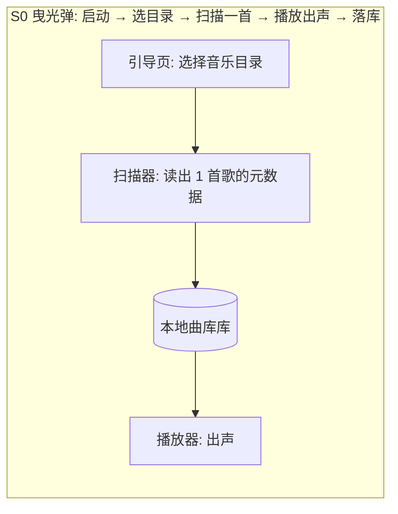
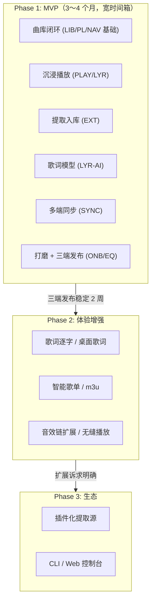

# 产品开发分阶段规划书：iA Music

- **需求/功能名称**：iA Music — 本地优先的沉浸式音乐播放器（Android / Windows / Linux）
- **规划编制时间**：2026-10-16
- **规划状态**：FROZEN（MVP 范围经开发者裁定，见 `_06_dev_process/_03_qa_log/DEC-002`）
- **产品负责人**：开发者（单人）
- **当前实施目标**：Phase 1 (MVP)
- **关联设计与需求**：
  - 总览 PRD：`_02_feature_spec/_01_human_prd/overview_prd.md`
  - 双轨原型：`_02_feature_spec/_04_prototype_wireframe/main_prototype.md`
  - 宏观品味宪章：`/DESIGN.md`

> [!NOTE]
> **定位原则**：MVP 范围已在产品设计沟通（审讯）阶段由开发者裁定：**Q1「全部纳入」**（F1-F8 全量入 MVP，宽时间箱）。本规划书把结论落盘，并以**内部垂直切片（S0–S6）**控制交付节奏，杜绝 Big Bang 式无演示推进。

---

## 1. 核心验证假设、团队胃口 (Appetite) 与 MVP 定位

- **单一核心验证假设 (Single Risky Assumption)**：把「B 站链接 → 本地相册级曲库 → 沉浸播放」串成一条 3 步闭环后，用户愿意停止"文件夹 + 通用播放器"的凑合状态，把 iA Music 作为自用主力收听工具（并愿意在多端之间保持同一份曲库与收藏）。
- **团队胃口与时间箱 (Appetite & Timebox · 开发者裁定)**：
  - **规格**：`Wide Batch` —— 总预算 **3～4 个月**，每阶段允许翻倍（开发者裁定，见 DEC-002 Q2）；
  - **断路器原则 (Circuit Breaker)**：单用途实现受阻时**砍功能保主链**（如：音效增强可降级为基础预设；同步通道可分通道灰度），**绝不延长总时间箱**。
- **MVP 核心成功指标**：
  1. 主核心场景（B 站链接 → 3 步内进入沉浸播放）100% 跑通，无阻塞卡点；
  2. 三端（Android 64 位 / Windows / Linux）均可安装并以同一套代码运行同一曲库数据；
  3. 1 万首级曲库扫描完成 ≤ 2 分钟（SSD 参考值），播放启动 ≤ 300ms。
- **本阶段总体实施策略**：垂直曳光弹先行，按 S0→S6 切片递进；每片完成后可演示、可回归。

---

## 2. 人机交互对齐备忘录 (Interaction Alignment & CEO Cut)

**MVP 范围裁定发生在产品设计沟通（审讯）阶段，先于详细规格**。结论回溯：`_06_dev_process/_03_qa_log/`（DEC-001 ~ DEC-003）。

| 对齐维度 | 核心提问内容 | 决策者确认结论与裁剪依据 |
|---|---|---|
| **单一核心假设** | MVP 最根本解决的单一痛点是什么？ | 确认：本地曲库的沉浸播放 + 一键提取入库闭环（DEC-003 Q2/Q3） |
| **CEO 质疑式裁剪提案** | Agent 建议 F4/F5/F6/Linux 打包顺延，是否采纳？ | **开发者不采纳裁剪：全部纳入 MVP**（DEC-002 Q1）；以内部切片顺序控制风险 |
| **管理台策略** | 首期是否构建可视化配置后台？ | 无后台类需求；但**设置页**是用户功能（仓库管理/同步/歌词模型管理），保留 |
| **团队胃口** | 时间箱？ | 宽时间箱 3～4 个月，断路器原则不变（DEC-002 Q2） |
| **首日切片与准出** | Day 1 垂直切片与验收断言？ | S0：选目录→扫描一首→播放出声→落库；以 Gherkin 全绿 + 阶段 6 门禁为准出 |
| **同步语义** | 音频本体是否参与同步？ | 含音频本体（DEC-002 Q4）；GitHub 仅轻数据（DEC-003 顺带确认②） |
| **提取范围** | 站点范围？ | 引擎能力制，B 站（登录态高音质）为重点保证（DEC-002 Q5） |

---

## 3. 全量功能池 MoSCoW 分级与分期矩阵

> 功能编号与 PRD 索引一致（`FEAT-*`）；**Phase 1 = Must-have 全量**。

| 功能编号 | 功能名称 | 所属模块 | MoSCoW 分级 | 实施阶段归属 | 切片/说明 |
|---|---|---|---|---|---|
| `FEAT-LIB-01` | 音乐仓库与曲库管理（目录、扫描、元数据、封面刮削、文件变更） | 曲库 | **Must-have** | **Phase 1 (MVP)** | Slice S1 |
| `FEAT-PL-01` | 歌单、红心与播放历史 | 曲库 | **Must-have** | **Phase 1 (MVP)** | Slice S1 |
| `FEAT-PLAY-01` | 沉浸式播放与播放增强（控制/队列/后台/均衡器/倍速） | 播放 | **Must-have** | **Phase 1 (MVP)** | Slice S2 |
| `FEAT-LYR-01` | 歌词显示与编辑（.lrc/内嵌/偏移） | 歌词 | **Must-have** | **Phase 1 (MVP)** | Slice S2 |
| `FEAT-EXT-01` | 分享链接音频提取入库（B 站登录态高音质 + 多站点引擎） | 提取 | **Must-have** | **Phase 1 (MVP)** | Slice S3 |
| `FEAT-LYR-02` | 模型歌词提取（本地小模型 ASR → LRC） | 歌词 | **Must-have** | **Phase 1 (MVP)** | Slice S4 |
| `FEAT-SYNC-01` | 多端同步（WebDAV/OneDrive/Google Drive + GitHub 轻数据；百度网盘移除，DEC-008） | 同步 | **Must-have** | **Phase 1 (MVP)** | Slice S5 |
| `FEAT-NAV-01` | 三 Tab 探索（音乐空间 / 搜索 / 我的） | 壳层 | **Must-have** | **Phase 1 (MVP)** | Slice S1 起增量 |
| `FEAT-ONB-01` | 首次引导与设置（FTUE / 仓库设置 / 外观（主题·语言，DEC-005）/ 合规声明 / 关于） | 壳层 | **Must-have** | **Phase 1 (MVP)** | Slice S0/S6 |
| — | 歌词逐字（KTV 效果） | 歌词 | Should-have | Phase 2 | 待 MVP 反馈 |
| — | 智能歌单（按风格/年代自动分组） | 曲库 | Should-have | Phase 2 | |
| — | m3u 歌单导入导出 | 曲库 | Should-have | Phase 2 | |
| — | 浅色主题 | 壳层 | Should-have（P1） | **Phase 1 (MVP)** | DEC-005 提前入 MVP（随 ONB 外观设置） |
| — | 桌面歌词悬浮窗 | 歌词 | Could-have | Phase 2 | |
| — | 音频淡入淡出/无缝播放 | 播放 | Could-have | Phase 2 | |
| — | 插件化提取源（用户自定义规则） | 提取 | Won't-have | Phase 3 | |
| — | 开放 CLI / 局域网 Web 控制台 | 生态 | Won't-have | Phase 3 | |
| — | 在线流媒体 / 社交评论 / iOS·macOS | — | Won't-have | 明确反目标 | |

---

## 4. 阶段一：MVP 实施细则与垂直切片路径 (Tracer Bullet Path)

### 4.1 Day 1 垂直曳光弹切片（S0）
贯穿 运行壳 → 数据层 → 文件系统 的最窄通路，首日可演示：

- **验证目的**：打通"目录→曲库→播放"全链路，尽早暴露三端打包与音频解码风险。

### 4.2 MVP 内部切片序列（全部 Must-have，按此顺序交付）

- **S0**：选目录 → 扫描（最小元数据）→ 播放 → 落库；（Android/Windows 各跑通一次打包）
- **S1**：完整曲库（元数据/封面刮削/文件变更检测）+ 歌单/红心/历史 + 「我的」「本地曲库」页
- **S2**：沉浸播放页 + 队列/循环/后台播放 + 歌词显示与偏移
- **S3**：粘贴链接 → 解析 → 选音质 → 下载排队 → 入库刮削；B 站扫码登录（高音质）
- **S4**：本地小模型歌词提取（模型下载管理 + 生成队列 + 预览保存）
- **S5**：同步中心（4 云盘 + GitHub 轻数据；音频本体上传/下载；冲突策略）
- **S6**：音乐空间页完整（随机/最近入库/歌单角）+ 搜索 + 均衡器/音效 + FTUE 完整（含外观：主题·语言）+ 三端发布物

### 4.3 MVP 明确排除项 (Out-of-Scope / Hard Non-Goals)

- ❌ 在线流媒体曲库、音乐推荐云算法（"随机"是本地随机播放引擎，非在线推荐）；
- ❌ 社交、评论、歌单分享社区；
- ❌ iOS / macOS；❌ 32 位 Android；
- ❌ 歌词逐字、音效链深度定制（入 Phase 2 池）；
- ❌ 绕过 DRM/付费墙的任何能力（提取功能仅面向用户可合法访问的内容，见合规声明）。

### 4.4 MVP 准出与验收断言 (Exit Criteria)

- [ ] S0 曳光弹在 Android 与 Windows 上冒烟通过；
- [ ] 主核心场景「B 站链接 → 3 步内沉浸播放」在正常网络下 100% 完成；
- [ ] 三端同一套代码、同一份曲库数据模型，均可安装运行；
- [ ] 歌词显示/提取、同步（至少 WebDAV + GitHub 两通道）、封面刮削可用；
- [ ] 异常输入（失效链接/未登录/同步断网/无歌词）均有明确界面反馈与原位恢复路径；
- [ ] 全部范围的 Gherkin DoD 全绿，通过阶段 6 门禁与本地提交。

---

## 5. 阶段二：体验与能力增强阶段规划 (Phase 2)

- **实施目标**：打磨体验、补齐效率特性与个性化。
- **规划特性范围**：歌词逐字、智能歌单、m3u 导入导出、桌面歌词悬浮窗、淡入淡出/无缝播放、音效链扩展。
- **启动前提**：Phase 1 MVP 三端发布并稳定运行 ≥ 2 周，收集真实使用反馈。

---

## 6. 阶段三：规模化与生态集成阶段规划 (Phase 3)

- **实施目标**：可扩展性与自动化生态。
- **规划特性范围**：插件化提取源、开放 CLI/局域网 Web 控制台、多仓库分区挂载。
- **启动前提**：MVP + Phase 2 稳定，出现明确的扩展诉求（如新站点提取需求频繁）。

---

## 7. 演进路线图与阶段依赖关系

