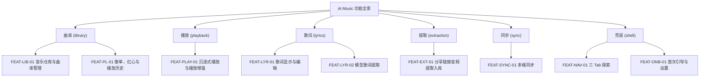

# 产品全景需求总览说明书 (Overview PRD)：iA Music

- **项目/系统全称**：iA Music — 本地优先的沉浸式音乐播放器
- **创建时间**：2026-10-16
- **版本**：v1.3.0（v1.2 增补：DEC-005 主题/语言三选；DEC-006 术语更名 发现→音乐空间、私人兆赫→随机 与官网实拍视觉对齐；v1.2.1：DEC-006 D6-7「随机」轮盘页终稿并入；v1.3.0：DEC-008 同步通道池移除「百度网盘」）
- **状态**：REVIEWED（待开发者冻结签收）
- **宏观品味宪章继承**：`Inherits: /DESIGN.md`
- **对应架构设计**：`hs_dev_docs/_03_architecture_design/_01_system_architecture/`（阶段 2 产出）
- **MVP 范围基线**：`_01_product_vision/_02_phased_roadmap/iA-Music_phased_plan.md`（全量 Must-have）
- **需求决策日志**：`_06_dev_process/_03_qa_log/`（DEC-001 ~ DEC-008）

> [!NOTE]
> 本总览承载全局业务全景、模块矩阵与特性索引；微观施工图分拆至 `features/{feature_key}_prd.md`。

---

## 1. 系统业务全景与模块矩阵 (System Scope & Modules)

**一句话定位**：把你的本地音乐（含 B 站等来源提取的音频）变成一间可跨端收听的私人电台。

| 模块标识 | 模块名称 | 核心职责 | 包含特性清单 |
|---|---|---|---|
| `library` | 曲库 | 音乐仓库、扫描、元数据、歌单/红心/历史 | `FEAT-LIB-01`, `FEAT-PL-01` |
| `playback` | 播放 | 播放引擎面向用户的控制、队列、沉浸播放页、音效 | `FEAT-PLAY-01` |
| `lyrics` | 歌词 | 歌词显示/编辑与本地模型提取 | `FEAT-LYR-01`, `FEAT-LYR-02` |
| `extraction` | 提取 | 分享链接 → 音频入库（B 站登录态 + 多站点引擎） | `FEAT-EXT-01` |
| `sync` | 同步 | 多端轻/重数据同步与通道管理 | `FEAT-SYNC-01` |
| `shell` | 壳层 | 三 Tab 探索导航、首次引导、设置与关于 | `FEAT-NAV-01`, `FEAT-ONB-01` |

### 1.1 全局反目标（Non-Goals）

在线流媒体、社交评论、iOS/macOS、32 位 Android、任何绕过 DRM/付费墙的能力。

### 1.2 全局角色

单一角色 `ROLE_OWNER`（设备持有者本人）：拥有全部数据与本地文件，无多用户/权限体系。数据同步通过用户自己的云盘/GitHub 账号完成，产品不引入自有服务端。

---

## 2. 全局功能特性索引映射表 (Feature Index Matrix)

| 特性ID | 特性名称 | 所属模块 | 优先级 | 状态 | 规格说明书路径 (PRD) | 界面原型 (Prototype) |
|---|---|---|---|---|---|---|
| `FEAT-LIB-01` | 音乐仓库与曲库管理 | `library` | `P0` | `active` | `features/library_prd.md` | `_04_prototype_wireframe/main_prototype.md#p-library` |
| `FEAT-PL-01` | 歌单、红心与播放历史 | `library` | `P0` | `active` | `features/playlists_prd.md` | `main_prototype.md#p-mine` |
| `FEAT-PLAY-01` | 沉浸式播放与播放增强 | `playback` | `P0` | `active` | `features/playback_prd.md` | `main_prototype.md#p-player` |
| `FEAT-LYR-01` | 歌词显示与编辑 | `lyrics` | `P0` | `active` | `features/lyrics_display_prd.md` | `main_prototype.md#p-lyrics` |
| `FEAT-LYR-02` | 模型歌词提取 | `lyrics` | `P0` | `active` | `features/lyrics_ai_prd.md` | `main_prototype.md#p-lyrics` |
| `FEAT-EXT-01` | 分享链接音频提取入库 | `extraction` | `P0` | `active` | `features/extraction_prd.md` | `main_prototype.md#p-extract` |
| `FEAT-SYNC-01` | 多端同步 | `sync` | `P0` | `active` | `features/sync_prd.md` | `main_prototype.md#p-sync` |
| `FEAT-NAV-01` | 三 Tab 探索（音乐空间/搜索/我的） | `shell` | `P0` | `active` | `features/navigation_prd.md` | `main_prototype.md#p-discover` |
| `FEAT-ONB-01` | 首次引导与设置 | `shell` | `P0` | `active` | `features/onboarding_prd.md` | `main_prototype.md#p-onboarding` |

---

## 3. 全局功能架构树 (System Functional Architecture Tree)

---

## 4. 端到端核心旅程 (Core Journeys)

### 4.1 主核心旅程：B 站链接 → 沉浸播放（Aha 路径，≤3 步）

### 4.2 FTUE 冷启动旅程（首次进入，空曲库）

### 4.3 次核心旅程：一处收藏，处处可听（跨端同步）

---

## 5. 全局业务规则（跨模块）

| 规则 | 内容 |
|---|---|
| 数据归属 | 所有数据（曲库/歌单/歌词/设置）默认仅存本机；只有用户显式配置同步通道后才离开设备 |
| 隐私 | 无遥测、无自有服务端；账号凭据（B 站 Cookie、云盘 Token）加密存储于本机安全存储 |
| 删除策略 | 从曲库删除 = 仅解除入库记录；**不物理删除用户音频文件**；同步删除仅传播"墓碑"记录，云端音频文件不自动物理删除（防误删） |
| 合规 | 提取功能面向用户可合法访问的个人内容备份；首次使用展示合规声明并需确认；不实现任何绕过 DRM/付费墙能力 |
| 封面抓取 | 仅当曲目无任何封面来源时联网搜索封面（按歌手/专辑/歌名匹配），结果保存到本地（音频同目录封面文件，**不修改音频本体**）；不覆盖内嵌封面与已有封面文件；失败不影响扫描与播放；设置可关闭（DEC-004） |
| 播放回写 | 播放历史/红心等为用户资产，与曲库数据同源同步 |
| 主题与语言 | 界面主题（深色/浅色/跟随系统）与界面语言（中文/English/跟随系统）各三选一，本地持久化；应用名 iA Music 不译；歌曲自身信息（曲名/歌手/专辑/歌词/文件名/歌单名）不随语言变化；胶片帧在浅色主题下保持深色实体（DEC-005） |

---

## 6. 全局质量约束 (Quality Constraints)

| 维度 | 约束值（验收口径） | 验证方式 |
|---|---|---|
| 曲库扫描 | 1 万首级首次扫描 ≤ 2 分钟（SSD 参考）；二次启动增量扫描 ≤ 15s | S1 切片实测 |
| 播放启动 | 已入库曲目点击到出声 ≤ 300ms（常规设备） | S2 切片实测 |
| 歌词提取 | 4 分钟歌曲 ≤ 2 分钟（中端桌面 CPU，小模型）；Android 目标 ≤ 2 倍时长 | S4 切片实测，超限降级标注 |
| 同步 | ≥100MB 单文件断点续传；失败可逐文件重试 | S5 切片实测 |
| 可访问性 | 触控 ≥44px；正文对比度 ≥4.5:1；键盘可达（桌面） | 原型 6 项检查 + S6 走查 |
| 稳定性 | 崩溃率：切歌/扫描/同步过程零崩溃（自用基线） | 各切片回归 |

---

## 7. 术语表（关键动词）

| 术语 | 定义 |
|---|---|
| 音乐仓库 | 用户指定的本地目录（可为云盘同步盘目录），应用从中扫描音乐 |
| 入库 | 音频文件与其元数据被收进曲库并建立索引的过程 |
| 提取 | 从分享链接下载音频流、转存为本地音频文件并入库的过程 |
| 随机 | 音乐空间的本地随机播放模式（复刻豆瓣 FM 私人兆赫心智，DEC-006 更名）；池=全库−少播名单，单轮不重复；页面形态=经典兆赫轮盘页（D6-7，仅上滑切歌） |
| 轻数据 | 歌单、元数据、歌词、播放记录、红心等小型结构化数据 |
| 重数据 | 音频文件本体 |
| 通道 | 一个同步后端（WebDAV / OneDrive / Google Drive / GitHub；百度网盘已移除，DEC-008） |
