# 产品设计语言与界面原型规范：iA Music 全应用主原型（Main Prototype）

- **功能模块**：全应用壳层与全部一级页面（引导/音乐空间/搜索/我的/曲库/随机/播放/歌词/提取/同步/设置）
- **创建时间**：2026-10-16
- **介质形式**：双轨原型（Mermaid 拓扑 + ASCII 空间比例线框） / UX 四定律 / Design Tokens 规范
- **关联 PRD**：`_02_feature_spec/_01_human_prd/overview_prd.md` 及 `features/` 下 9 篇子特性 PRD
- **可交互 HTML 原型预览**：`_02_feature_spec/_03_prototype_html/main_prototype.html`（多端视口仿真与四态直读）
- **宏观品味宪章继承**：`Inherits: /DESIGN.md`
- **状态**：DRAFT（待开发者视觉签收 → 随阶段 0 冻结）

> [!NOTE]
> 本文件为全应用主原型，覆盖全部一级页面与关键弹层；每个特性子文档的局部原型以本章节锚点为准（`#p-onboarding`、`#p-discover`、`#p-search`、`#p-mine`、`#p-library`、`#p-shuffle`、`#p-player`、`#p-lyrics`、`#p-extract`、`#p-sync`、`#p-settings`）。
> 全局调性、基准 Tokens 与 Anti-Slop 禁令继承根目录 `/DESIGN.md`；本文件只定义模块特化的组件状态与页面流。HTML 原型为可视化真理源。

---

## 1. 视觉调性与设计哲学 (Aesthetic & Mood)

- **设计隐喻与具体参照物**：**"深夜的私人电台直播间 × 胶片放映机"**——一间暗房，播放页那张专辑封面像**一帧胶片**（底边打孔、标签贴角）被聚光灯照亮；这是第一参照页 `01_player_private_mhz.png`（原「私人兆赫」播放页，DEC-006 起称「随机」）的复刻，也是本产品最想要的画面（DEC-004）。参照物：豆瓣 FM 7.1.2 的极简电台气质（`_01_product_vision/_01_design_charter/reference/doubanfm-7.1.2/` 商店截图 01–04 + 官网实拍 05–09），叠加 2024+ 深色 OLED 质感。
- **受众与核心心智**：把本地音乐当"私人电台"听的重度听歌者；感知关键词：深沉、沉浸、克制、音乐优先（封面/歌词是画面主角，UI 是服务生）。
- **内容密度 (Density)**：`Balanced`（音乐空间页区块间距 24px）；播放/歌词页 `Airy`（宽松通透）。

---

## 2. Design Tokens 规范定义

> 基础 Tokens 全量继承 `/DESIGN.md`（暗色画布 `#0A0B0D`、表面 `#16181C`/`#1F2228`、强调绿 `#4BE0A3`（DEC-006 提亮）、红心 `#FF5C7A`、系统字体栈、数字 `tabular-nums`）。以下仅补充本主原型新增的扩展语义 Token：

### 2.1 色彩体系（扩展）

| Token 标识 | 角色定义 | Hex 色值 | 使用场景与对比度约束 |
|---|---|---|---|
| `color.player.backdrop` | 播放页氛围底 | 封面模糊采样色 | `blur(≥60px) scale(1.2)` + 黑色渐变遮罩；文字对比度 ≥ 4.5:1 由遮罩保证 |
| `color.film.frame` | 胶片帧外框/打孔带底 | `#0D0F11` | 播放页胶片帧专用（外框 r18 / 画面 r10 / 内边距 10px） |
| `color.film.perf` | 打孔 | `rgba(255,255,255,0.16)` | 孔 7×11px r2 间距 8px；静态，无动效 |
| `color.film.tag` | 标签芯片 | `#4BE0A3` 实底 + `#07130D` 字 | 封面画面下缘 ≤2 个，11px（DEC-006 对齐官网实拍 05 的实底芯片） |
| `color.overlay.scrim` | 弹层遮罩 | `rgba(0,0,0,0.55)` | 底部弹层/全屏覆盖层之下 |
| `color.badge.missing` | 缺失文件徽标 | `rgba(255,255,255,0.12)` 底 + `#9BA1A8` 字 | 曲目行内 12px 徽标；整行 40% 不透明度 |
| `color.success` | 成功语义 | `#4BE0A3`（复用 accent） | 下载完成/同步成功 |
| `color.warning` | 告警语义 | `#F0B232` | 降级下载、空间不足 |
| `color.error` | 错误语义 | `#FF6B6B` | 校验失败、缺失、解析失败 |

### 2.2 排版层级（继承并应用）

- **字体族**：系统栈 `-apple-system, "Segoe UI", Roboto, "Noto Sans SC", sans-serif`；数字（时间/时长/进度/计数）强制 `tabular-nums`。
- **字阶**：`AppTitle 26px w700`（引导标语）/ `H1 22px w650`（页面标题）/ `TrackTitle 22px w650`（播放页曲名）/ `H2 15px w600`（区块标题）/ `Body 14px w400` / `Caption 12px w400` / `Lyrics 17px w500 行高1.8`。
- **跑马灯**：迷你条歌名-歌手超长时 8s 循环平移（`prefers-reduced-motion` 时改省略号）。

### 2.3 间距与圆角高程

- **间距步进**：4 / 8 / 12 / 16 / 24 / 32px；页面左右安全边距 20px（移动）/ 32px（桌面）。
- **圆角梯度**：徽标 999px / 缩略封面 8px / 卡片 12px / 大封面与随机卡 20px / 底部弹层顶部 20px。
- **主题与语言（DEC-005）**：深色（默认）/浅色/跟随系统三选；浅色 token：画布 `#F6F7F9` / 表面 `#FFFFFF` / 抬升 `#ECEEF1` / 主文本 `#17191C` / 次文本 `#6E747C` / 分隔 `rgba(0,0,0,0.08)` / accent `#17A566`；胶片帧在浅色下保持深色实体。界面语言 中文/English/跟随系统三选；应用名与歌曲自身信息不译。
- **高程（暗色约定）**：Flat=1px `rgba(255,255,255,0.08)` 描边；Raised=`0 2px 8px rgba(0,0,0,0.4)`；Overlay=`0 16px 40px rgba(0,0,0,0.6)`（弹层）；Scrim 遮罩从不使用投影替代。

---

## 3. UX 认知心理学与可用性四定律落地规范

1. **渐进式披露 (Progressive Disclosure)**：
   - **首屏显露（核心 20%）**：音乐空间页 = 随机大卡 + 最近入库；播放页 = 封面 + 三键 + 进度；提取页 = 粘贴框 + 开始提取。
   - **按需折叠（次级 80%）**：倍速/音效/歌曲信息折叠进「更多 ⋯」；均衡器 5 段为二级页；同步失败明细/冲突副本折叠列表；健康检查等维护操作沉到设置。
2. **视觉层级与扫视动线 (Visual Hierarchy)**：
   - **一级锚点**：随机大卡（音乐空间页）、播放键（播放页 64px）、解析结果卡主按钮（提取页）。
   - **二级信息**：曲目行标题+歌手、任务进度、数据卡数字。
   - **三级弱化**：时长、来源标注、同步时间戳（`#9BA1A8` 12px）。
3. **费茨定律与希克定律 (Fitts's & Hick's Law)**：
   - 移动端主触控 ≥ 44×44px；播放键热区 64px；三键间距 ≥ 40px；删除/移除类操作收进行尾「⋯」二级菜单且二次确认；
   - 主导航恒定：移动 3 Tab；桌面左栏 ≤ 6 项；弹层选项 ≤ 7 条（队列长列表可滚动）。
4. **真实界面微文案规范 (UX Microcopy)**：
   - 主按钮 = 具象动词 + 宾语：`开始提取` `保存歌词` `重新扫描` `立即同步` `清空少播名单`；
   - 错误 = 原因 + 修复动作：`链接解析失败：链接可能已失效，或该内容需要登录 → [登录 B 站] [重试]`；
   - 空态永远给出路：空曲库 → `[选择音乐文件夹] [粘贴一条 B 站链接]`；无歌词 → `[生成歌词] [手动粘贴]`。

---

## 4. 核心组件全状态矩阵 (Component State Matrix)

### 4.1 播放键 (Play/Pause Button)
| 状态 | 视觉表现 | 交互行为 |
|---|---|---|
| 默认（暂停中） | 64px 圆形，白描边柄图标，透明底 | 悬停：accent 20% 光晕；按下：scale 0.96 |
| 播放中 | 图标切换为双竖线 `⏸` | 点击暂停，图标 150ms 交叉淡化 |
| 加载中（≤300ms 空档） | 图标原位换成 1.5s 旋转弧线 | 防抖屏蔽重复点击 |
| 禁用（无任何会话/解码失败） | 40% 不透明度 | Tooltip/Toast 说明原因 |

### 4.2 红心按钮 (Heart)
| 状态 | 视觉表现 | 交互行为 |
|---|---|---|
| 未红心 | 白描边心形 24px | 点击 → 乐观填充 `#FF5C7A` + 150ms 弹跳 |
| 已红心 | 实心 `#FF5C7A` + 轻微外发光 | 再点取消；失败则回滚并 Toast「操作失败，请重试」 |
| 禁用 | 40% 不透明度 | 曲库未就绪时 |

### 4.3 表单输入框（粘贴框/搜索框/歌单命名）
- **默认**：`#16181C` 底 1px `rgba(255,255,255,0.08)` 描边；
- **聚焦**：描边变 `#4BE0A3`，2px 外光晕 `rgba(75,224,163,0.25)`；
- **错误**：描边 `#FF6B6B`，框下内联红字修复建议，**已输入内容 100% 保留**；
- **禁用**：40% 不透明度，光标 `not-allowed`。

### 4.4 曲目行 (Track Row)
| 状态 | 视觉表现 | 交互行为 |
|---|---|---|
| 默认 | 封面 48px 圆角 8px + 标题 15px w600 + 歌手 13px `#9BA1A8` | 点击整行播放；悬停 4% 白底 |
| 播放中 | 标题色变 `#4BE0A3` + 封面右下 3 根跳动 EQ 条 | 再次点击回到播放页 |
| 文件缺失 | 整行 40% 不透明度 + 「文件缺失」徽标 + 行尾「定位文件」 | 点击提示路径并打开所在目录 |
| 选中批量 | 左侧复选框 + 行底 accent 8% | 长按/右键进入多选 |

---

## 5. 双轨页面信息架构与多端四态原型 (Dual-Track Multi-Platform Prototypes & UI Specs)

> **多端适用声明**：目标前端形态：`[x] 移动端 (Android App)` / `[x] 桌面端 (Windows/Linux Desktop)` / `[ ] Web 端`。
> 移动端基准 390×844；桌面基准 1280×800，内容区 Max 1080px 居中。

### 5.0 全局壳层 (App Shell)

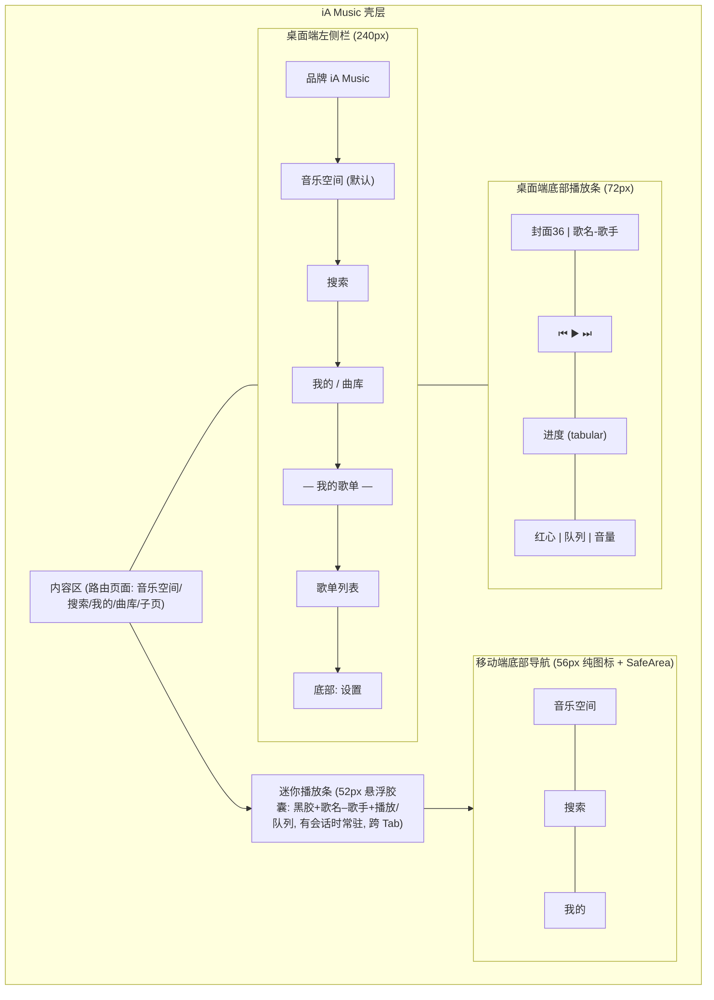

```text
[移动端 390px — 音乐空间页]                     [桌面端 1280px — 音乐空间页]
+--------------------------------+             +------------------------------------------------------------+
| 音乐空间                        |             | [Nav 240px]  | [Main Max1080 centered      ]                 |
|                                |             |  iA Music    |  音乐空间                                     |
| +----------------------------+ |             |  ● 音乐空间  |  +------------------------------------------+ |
| | ♫  随机                    | |             |  ○ 搜索      |  | 随机 · 随机播放我的曲库  〜❘     (⏸)     | |
| |    随机播放我的曲库 〜❘ (⏸)| |             |  ○ 我的      |  +------------------------------------------+ |
| +----------------------------+ |             |  ○ 本地曲库  |  最近入库 ──────────────────────────────── |
|                                |             |  — 我的歌单  |  [封面][封面][封面][封面][封面] 横滑        |
| 最近入库 ─────────────        |             |  · 深夜电台  |  我的歌单 ──────────────  新建歌单          |
| [封面][封面][封面][封面]      |             |  · 通勤       |  [卡][卡][卡][卡]                           |
|                                |             |  ⚙ 设置      |                                             |
| 我的歌单 ── 新建歌单           |             +------------------------------------------------------------+
| [卡][卡][卡]                  |             | ▶ 《夜航》- 陈粒   ⏮ ▶ ⏭  01:23 ━━━●──── 04:02  ♥ |☰|  |
|                                |             +------------------------------------------------------------+ (H72)
| ──────────────────────────     |
| (● 夜航 – 陈粒    ▶ ☰)         | <- Mini 52px 悬浮胶囊（黑胶+播放）
| [⌂]         [🔍]         [👤]  | <- Tab 56px（纯图标、选中态高亮）
+--------------------------------+
```

---

### 5.1 `#p-onboarding` 首次引导（两步 FTUE）

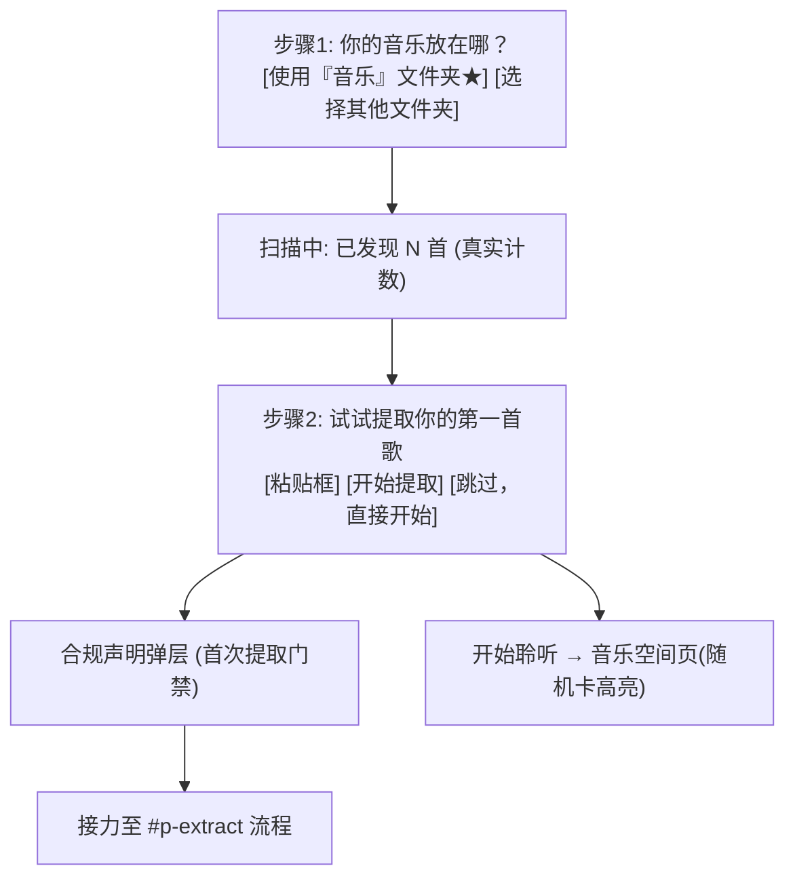

```text
+-- 状态一: 正常/首步 ----------------------+
|           你的音乐放在哪？  (26px w700)   |
|  +------------------------------------+  |
|  |  🗂 使用『音乐』文件夹        (★)   |  |
|  |     + 已发现 120 首 (tabular)       |  |
|  +------------------------------------+  |
|        选择其他文件夹 (次按钮 44px)       |
|        ● ○  步骤指示                      |
+------------------------------------------+

+-- 状态二: 加载(扫描中) --------------------+
|  已发现 128 首...  (tabular, 实时+1)      |
|  [███████░░░░░░] 扫描 2/3 目录             |
+------------------------------------------+

+-- 状态三: 空 ------------------------------+
|  你的音乐放在哪？                          |
|  (未选择目录 → 仅两个按钮, 无计数区)       |
+------------------------------------------+

+-- 状态四: 错误 ----------------------------+
|  ⚠ 无法访问该文件夹（权限或设备未连接）    |
|  [重新选择文件夹]  [跳过，直接开始]        |
+------------------------------------------+
```

---

### 5.2 `#p-discover` 音乐空间页（随机）

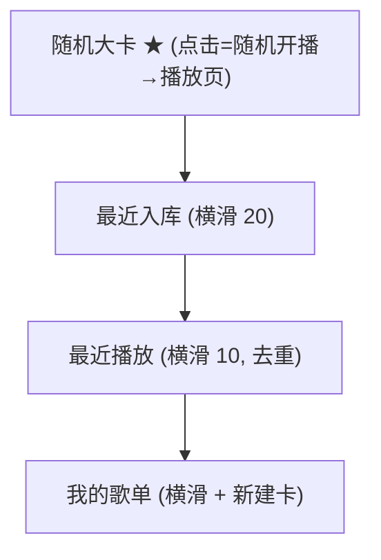

```text
+-- 正常态 (Populated) -----------------------------+
|  音乐空间                          [⚙]            |
|  +---------------------------------------------+  |
|  | ♫  随机                                     |  |
|  |    随机播放我的曲库  〜❘ 波形      (白圆⏸)  |  |
|  +---------------------------------------------+  |
|  最近入库 ─────────────────────────               |
|  [封面][封面][封面][封面][封面][封面]  →           |
|  我的歌单 ─────────────────   ＋新建歌单           |
|  [卡(▶)][卡(▶)][卡][＋]                           |
+---------------------------------------------------+

+-- 空态 (Empty) ------------------------------------+
|  音乐空间                                         |
|  随机                                             |
|  曲库是空的。先导入音乐，才能随机播放。            |
|  [选择音乐文件夹 ★]  [粘贴一条 B 站链接]          |
+---------------------------------------------------+

+-- 加载态 (Loading) --------------------------------+
|  [░░░░░░░░ 随机卡骨架 (绿渐变占位) ░░░░░░░░░░░]    |
|  [░][░][░][░]  最近入库骨架 (CLS=0)               |
+---------------------------------------------------+

+-- 错误态 (Error) ----------------------------------+
|  ⚠ 本地索引需要重建                               |
|  曲库文件与收藏均未受影响。                        |
|  [重建索引]                                       |
+---------------------------------------------------+
```

---

### 5.3 `#p-search` 搜索页

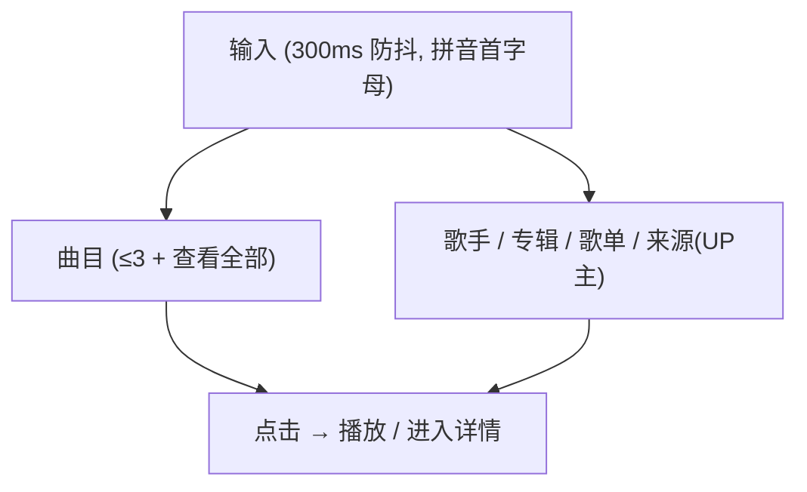

```text
+-- 正常态 ------------------------------------------+
|  (🔍 夜黑雾                                ✕)      | ← 胶囊输入（绿放大镜）
|  曲目 ────────────────                             |
|  [封面] 夜黑雾 - 某UP主        04:12    ♥          |
|  [封面] 夜的黑 - 某某          03:58    ♡          |
|  歌手 ───────────────  查看全部 >                  |
|  专辑 / 歌单 / 来源(UP主) ─ 分区结果…              |
|  分类浏览 (2 列大卡): POP#流行 | Rap#说唱 |         |
|  Folk#民谣 | Rock#摇滚 | Jazz#爵士 |               |
|  R&B#节奏布鲁斯 | ELECTRONIC#电子 | CLASSICAL#古典 |
|  (色值采样自官网实拍 07: #F07070/#FFA14E/#59DFA2/  |
|   #F75D5D/#B08CFF/#F0B04A/#4BDE8E/#D8DBDF)         |
+---------------------------------------------------+

+-- 空结果 ------------------------------------------+
|  没有找到与「XX」相关的音乐                        |
|  检查拼写，或换一个关键词试试。                    |
|  分类浏览 2 列大卡 (同上, 点击=按风格搜索)         |
+---------------------------------------------------+

+-- 加载(搜索中) ------------------------------------+
|  [🔍 搜索中...]  (轻提示, 不遮挡输入)              |
+---------------------------------------------------+

+-- 错误(索引异常) ----------------------------------+
|  ⚠ 搜索索引损坏，需要重建                         |
|  你的曲库与收藏不受影响。  [重建索引]              |
+---------------------------------------------------+
```

---

### 5.4 `#p-mine` 我的页

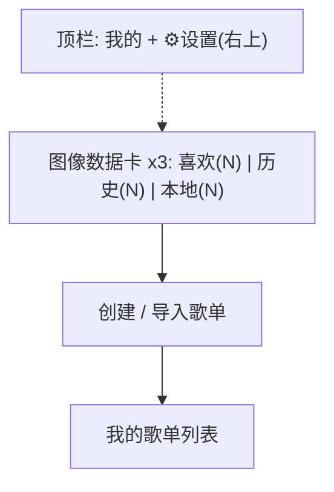

```text
+-- 正常态 ------------------------------------------+
|  我的                                       [⚙]   |
|  [♥ 喜欢 47] [◷ 历史 320] [⤓ 本地 1,204]          |
|  (图像卡: 渐变底 + 底部遮罩 icon+标签+计数)        |
|  我的歌单 ────────────────────────────── 3 ›       |
|  [+♪] 创建 / 导入歌单                              |
|       把喜欢的音乐装进歌单                         |
|  [封面] 深夜电台       32 首          ⋯            |
|  [封面] 通勤           18 首          ⋯            |
+---------------------------------------------------+

+-- 空态: 三卡计数为 0 + 「还没有歌单，创建一个吧」   |
+-- 加载: 三卡骨架 + 歌单行骨架                       |
+-- 错误: NA (纯本地数据, 无网络错误面; 索引异常并入搜索错误态) |
```

---

### 5.5 `#p-library` 本地曲库列表

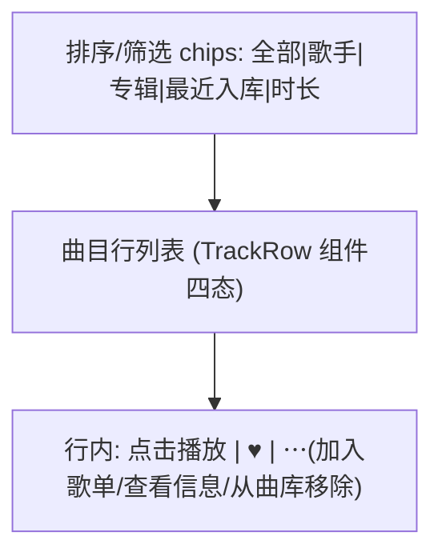

```text
+-- 正常态 ------------------------------------------+
|  ← 本地曲库 (1,204 首)                [重新扫描]   |
|  [全部] [歌手▾] [专辑▾] [最近入库] [时长]          |
|  [封面] 夜航                 陈粒     04:02  ♥ ⋯   |
|  [封面] 晚风                 某UP主   03:45  ♥ ⋯   |
|  [░灰░] 旧信 (文件缺失 - 40%)  [定位文件]          |
+---------------------------------------------------+

+-- 空态 --------------------------------------------+
|  还没有音乐                                        |
|  [选择音乐文件夹 ★]  [粘贴一条 B 站链接试试]       |
+---------------------------------------------------+

+-- 加载(扫描中) ------------------------------------+
|  已发现 856 首...  [███████░░░]   [取消]           |
+---------------------------------------------------+

+-- 错误 --------------------------------------------+
|  ⚠ 音乐仓库『D:\Music』无法访问                    |
|  其余曲库不受影响。  [重新连接] [移除仓库]         |
+---------------------------------------------------+
```

---

### 5.6 `#p-player` 沉浸式播放页（胶片帧 · 随机会话 · 含队列/EQ）

> **第一参照页（DEC-004，用户最重视）**：复刻 `01_player_private_mhz.png` 的播放页（DEC-006 起称「随机」）——封面以**胶片帧**呈现（外框 + 画面下缘标签芯片 + 框底打孔带）；从随机卡进入时此页即**随机播放**（顶栏标题「随机」）；布局对齐官网实拍 05：‹返回/「随机」/分享 顶栏、标题左对齐+红心右、头像+歌手行（⋯ 展开队列）、三行歌词预览（点击进歌词页）、进度白圆点、底部三键透明无底。随机会话另有经典兆赫轮盘视图（§5.11 `#p-shuffle`，DEC-006 D6-7，轮 16 终稿已确认）。

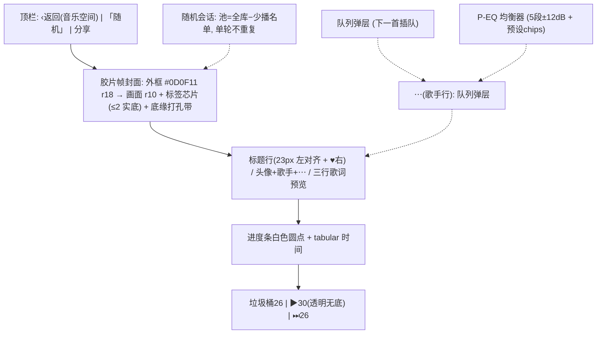

```text
+-- 正常态 (胶片帧 + 封面模糊氛围底) ------------------+
|  ‹              「随机」               ⤴分享       |
|   ┌──────────────────────────────┐                 |
|   │  [ 封面画面 320x320 r10 ]     │ ← 胶片外框 r18  |
|   │   #电子   #氛围  (实底芯片)   │   内边距 10px   |
|   ├──────────────────────────────┤                 |
|   │  ◦ ◦ ◦ ◦ ◦ ◦ ◦ ◦  (打孔带)   │                 |
|   └──────────────────────────────┘                 |
|    夜航                            ♥  (标题行)      |
|    (●) 陈粒                         ⋯ (队列)       |
|    起风了 夜色微凉                                 |
|    航向远方 没有灯塔          (三行歌词预览→歌词页) |
|    也许这就是终点                                  |
|    01:23  ━━━━━━●────────────────  04:02           |
|              (白色圆点, tabular)                   |
|        🗑          ▶ (30)          ⏭               |
+---------------------------------------------------+

+-- 空态 (无会话) -----------------------------------+
|  还没有在播放的音乐                                |
|  [从你的曲库随机播放 ★]                           |
+---------------------------------------------------+

+-- 加载态 (封面解码中) ------------------------------+
|   ┌──────────────┐                                 |
|   │  [夜] 首字母  │  (胶片帧保留；无假骨架图)       |
|   │  ◦◦◦◦◦ 打孔带 │  其余信息与控件即时应答        |
|   └──────────────┘                                 |
+---------------------------------------------------+

+-- 错误态 (解码失败) --------------------------------+
|  无法播放该文件（格式或文件损坏），已跳过。        |
|  顶部 Toast + 自动下一首                           |
+---------------------------------------------------+

[队列弹层] TOP 半透明 scrim → 底部弹层 r20:
  ┌──────────────────────────────────┐
  │ 播放队列 (3)               [清空] │
  │ ▎▶ 夜航 - 陈粒            (当前)  │
  │   晚风 - 某UP主          ⋯ 插队  │
  └──────────────────────────────────┘
```

**胶片帧规格**：外框 `#0D0F11` r18（内边距 10px，画面 r10）；标签芯片 ≤2 个（风格/来源标签，来自元数据 genre 或提取来源；无数据时隐藏芯片区）；打孔带孔 7×11px r2 间距 8px `rgba(255,255,255,0.16)`；封面来源链 = 内嵌 > 同目录 > 自动联网抓取（FEAT-LIB-01 REQ-LIB-08）> 首字母色块；静态呈现，不做胶片滚动动效。

---

### 5.7 `#p-lyrics` 歌词页（含 AI 生成流）

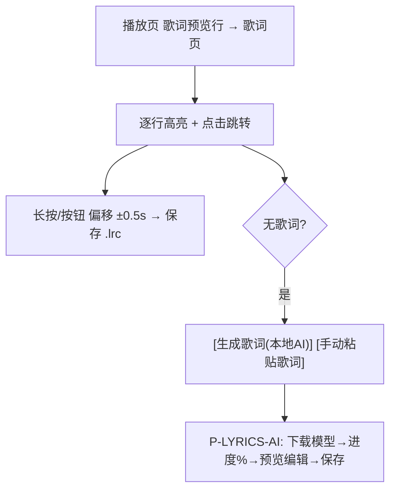

```text
+-- 正常态 ------------------------------------------+
|  (延续播放页封面氛围底, 同上)                      |
|   夜航 (当前行 · 绿 w650 居中)                     |
|   也许这就是终点                                   |
|   我曾试着追赶你 (45% 白)                          |
|   [−0.5s | +0.5s] [保存歌词]   (长按唤起偏移条)    |
+---------------------------------------------------+

+-- 空态(无歌词) ------------------------------------+
|  这首歌还没有歌词                                  |
|  [生成歌词（本地 AI）★]  [手动粘贴歌词]            |
+---------------------------------------------------+

+-- 加载(AI 推理中) ---------------------------------+
|  识别中... 68%  (tabular)  [取消]                  |
|  保持应用在前台可以获得更快速度                    |
+---------------------------------------------------+

+-- 错误(.lrc 损坏) ---------------------------------+
|  歌词文件格式异常，已按纯文本展示。               |
+---------------------------------------------------+
```

---

### 5.8 `#p-extract` 提取页（主 Aha 路径）

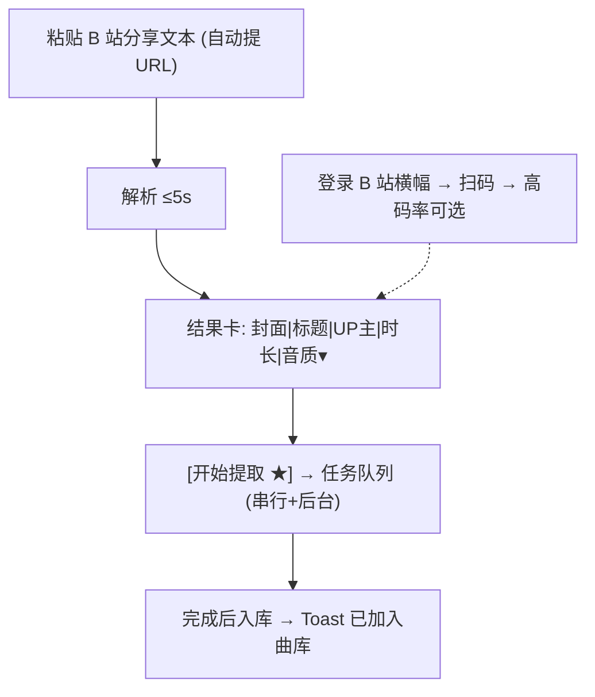

```text
+-- 正常态 ------------------------------------------+
|  提取音乐                                          |
|  +----------------------------------------------+ |
|  | 粘贴 B 站分享链接               [粘贴]        | |
|  +----------------------------------------------+ |
|  [封面64] 【原创】夜航-陈粒           UP:xxx      |
|           时长 04:02   音质: [最高可用 ▾]         |
|  将保存到 音乐仓库/提取/                           |
|  [ 开始提取 ★ ]    登录后可提取更高音质 [登录]     |
|  任务队列 ────────────────────                     |
|  ▸ 夜航.mp3    [███████░░] 72%  2.1MB/s   [取消]  |
+---------------------------------------------------+

+-- 空态 --------------------------------------------+
|  粘贴 B 站分享链接 → 复制分享 → 粘贴到这里         |
|  (三步图示引导)  历史任务为空                      |
+---------------------------------------------------+

+-- 加载(解析中) ------------------------------------+
|  [ 解析中 ⟳ ]  (按钮内 Spinner, 输入锁定)          |
+---------------------------------------------------+

+-- 错误 --------------------------------------------+
|  链接解析失败：链接可能已失效，或该内容需要登录。  |
|  [登录 B 站]  [重试]    ← 输入内容完整保留         |
+---------------------------------------------------+
```

---

### 5.9 `#p-sync` 同步中心

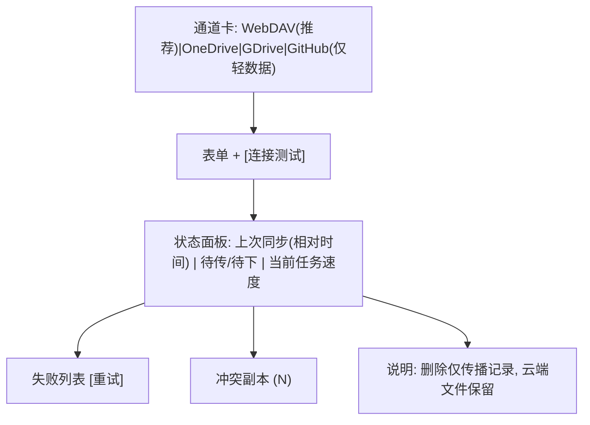

```text
+-- 正常态 ------------------------------------------+
|  ← 同步中心                           [立即同步]    |
|  ● 已连接: WebDAV · my.drive.com/iA-Music/         |
|  上次同步: 3 分钟前                                |
|  待上传 2 · 待下载 5                               |
|  ▼ 当前: 夜航.flac  [█████░░] 5.2MB/s             |
|  失败 (1)  晚风.mp3  授权过期      [重试]          |
|  冲突副本 (2) >                                    |
|  ⓘ 删除同步仅传播记录，云端音频文件不会被自动删除  |
+---------------------------------------------------+

+-- 空态(未配置) ------------------------------------+
|  选择同步通道                                      |
|  [WebDAV · 最稳定，推荐] [OneDrive] [Google Drive] |
|  [GitHub · 仅同步歌单/歌词/元数据]              |
+---------------------------------------------------+

+-- 加载(首次全量) ----------------------------------+
|  首次同步中 34%  当前: 晚风.flac  待 128/376       |
+---------------------------------------------------+

+-- 错误(授权过期) ----------------------------------+
|  ⚠ OneDrive 授权已过期                             |
|  本地数据不受影响。  [重新授权] [更换通道]         |
+---------------------------------------------------+
```

---

### 5.10 `#p-settings` 设置

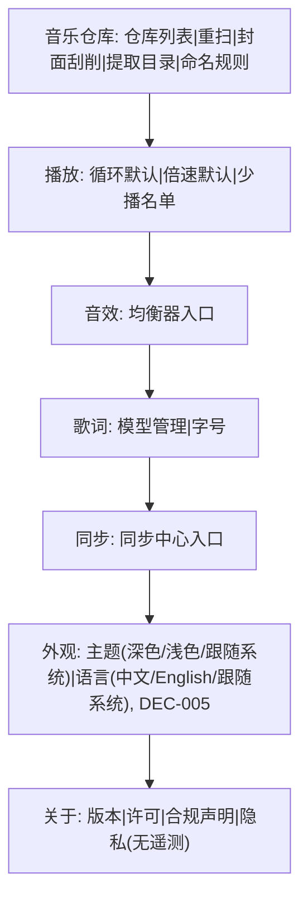

```text
+-- 正常态 ------------------------------------------+
|  ← 设置                                            |
|  音乐仓库        D:\Music, E:\BGM  >               |
|  自动扫描        [开]                              |
|  提取保存位置    音乐仓库/提取/  >                 |
|  播放 → 循环模式  列表循环 ▾                       |
|  音效 → 均衡器   默认 >                            |
|  歌词 → 模型     已就绪 142MB  >                   |
|  同步 → 同步中心 已连接 · 3分钟前  >               |
|  外观 → 主题     深色 ▾   (即时生效, DEC-005)      |
|  外观 → 语言     中文 ▾                            |
|  关于            1.0.0 · 合规声明 · 隐私(无遥测) > |
+---------------------------------------------------+
四态: 空/加载 NA（本地设置页）; 错误: 仅模型下载失败行内重试。
```

---

### 5.11 `#p-shuffle` 随机页（经典兆赫 · 唱片轮盘）

> **D6-7 裁定页（轮 16 终稿，开发者已确认）**：复刻豆瓣 FM 经典兆赫页形态（实测基准：参考图 `10_classic_radio_wheel.png`，610×1008）——歌曲海报卡沿左侧弧线层叠成唱片轮盘，当前卡 = 正在播放（方形焦点、最上层）。**仅上滑切歌**（无下滑）：手动上滑，或当前曲目播放结束自动上转。

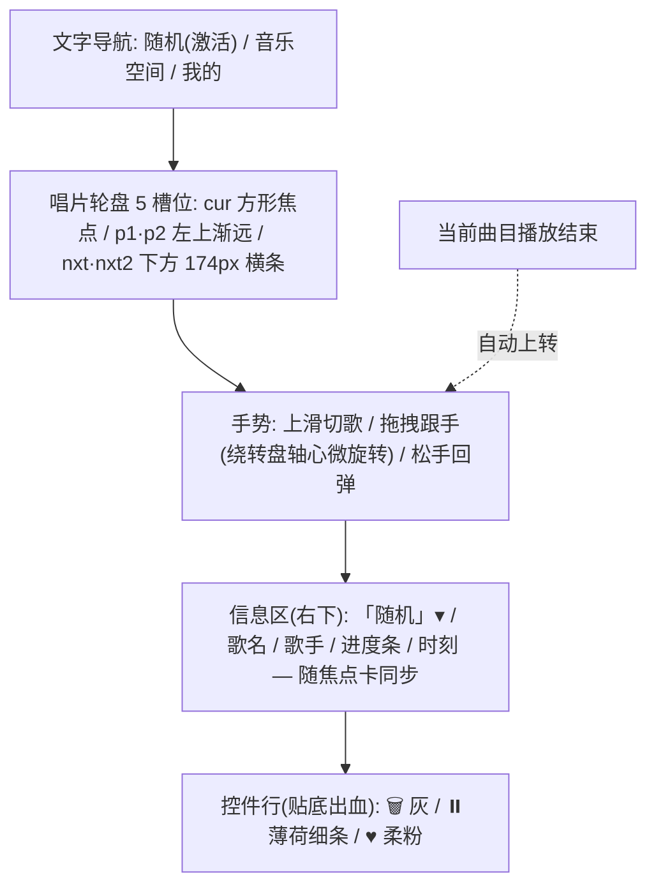

```text
+-- 正常态 (暗色; 浅色 = 纯白底同构) -----------------+
|  随机 ────   音乐空间   我的      (文字导航)        |
|                                                     |
|    ╲ [彩虹 p1]         ┌────────────────┐           |
|     ╲[薄荷 p2]         │  当前卡 · 方形  │           |
|      ╲                 │  海报(最大化)   │           |
|       ╲                └────────────────┘           |
|        ╲                            「随机」 ▾      |
|   ┌── [nxt 横条 174px] ──┐            夜航          |
|   ┌── [nxt2 横条 174px] ─┐            陈粒          |
|                                      ━━━━●────      |
|                                     01:23 / 04:02   |
|              上滑 — 播放下一首                       |
|     🗑             [⏸]            ♥   (贴底出血)    |
+-----------------------------------------------------+

+-- 空态 (曲库为空) ----------------------------------+
|  曲库是空的。先导入音乐，才能随机播放。             |
|  [选择音乐文件夹 ★]                                 |
+-----------------------------------------------------+

+-- 加载态 (封面解码中) ------------------------------+
|  当前卡位置 = 首字母色块占位（无假骨架图）；        |
|  信息区与控件即时应答                               |
+-----------------------------------------------------+

+-- 错误态 (解码失败) --------------------------------+
|  无法播放该文件（格式或文件损坏），已跳过。         |
|  顶部 Toast + 自动上转下一首                        |
+-----------------------------------------------------+
```

**轮盘规格（实测复刻值，DEC-006 D6-7 轮 14–16）**：
- **槽位与几何**：5 槽位（cur 方形 240px@手机内部 / p1·p2 与 nxt·nxt2 为 240×174px 横条）；卡组左沿刻意出血、沿左侧弧线层叠；层叠规则 = 下一卡顶边紧贴上一卡底边 +0.5~1px（套嵌）；层次仅靠**旋转渐进 + z 序遮挡**（静态卡无模糊/无缩放/无透明度弱化；仅切歌过渡的入场/出场卡允许淡入淡出）。
- **海报色板**：森林 / 奶黄 / 琥珀 / 彩虹 / 薄荷 5 组（默认排布即参考图配色）；海报本体色不随主题变，仅卡阴影/页面底色随主题。
- **切歌动效**：当前卡向上绕出淡出，下方卡顺时针上转归位；`transform .55s cubic-bezier(.32,.72,.28,1)`，横条高度 240↔174 平滑过渡（无跳变）。
- **信息区**（右下 128px 列）：「随机」▾ / 歌名 / 歌手 / 进度条（accent 填充）/ 时刻（tabular-nums），随焦点卡同步；「歌手→进度条」保持大留白节奏。
- **控件行**：贴底出血；🗑（灰）/ ⏸（**薄荷细条**，非白圆底）/ ♥（**柔粉**）；浅色页暂停/进度用薄荷专项色、心形柔粉、导航激活下划线薄荷——不沿用深色页的全局 accent。
- **手势**：仅上滑（触发阈值 ≈40px）；任意方向拖拽整盘跟手（上移 + 绕转盘轴心微旋转），松手回弹；无下滑、无点击切歌。
- **播完自动上转**：交互约定，demo 不做计时模拟（阶段 5 实现）。

---

## 6. 与 PRD / Gherkin DoD 映射矩阵

| 原型区块 | 关联特性 | 关联 Gherkin 场景 |
|---|---|---|
| `#p-onboarding` 步骤1/2 + 合规门禁 | `FEAT-ONB-01` | FTUE 30 秒闭环 / 合规门禁 |
| `#p-discover` 随机大卡 | `FEAT-NAV-01` | 一触即听 / 一轮不重复 |
| `#p-search` 分区结果 + 拼音 | `FEAT-NAV-01` | 拼音首字母搜索 |
| `#p-mine` 数据卡 | `FEAT-NAV-01` / `FEAT-PL-01` | 数据卡一致性 / 红心与歌单 |
| `#p-library` 曲目行四态 | `FEAT-LIB-01` | 扫描闭环 / 缺失恢复 / 移除不删文件 / 无封面自动抓取（REQ-LIB-08） |
| `#p-shuffle` 唱片轮盘 | `FEAT-NAV-01`（DEC-006 D6-7） | 随机一触即听 / 一轮不重复 / 垃圾桶 |
| `#p-player` 三键+氛围底 | `FEAT-PLAY-01` | 进入即播 / 垃圾桶 / 缺失跳过 |
| `#p-player` P-EQ | `FEAT-PLAY-01` (REQ-PLAY-07) | 均衡器实时生效或明示不支持 |
| `#p-lyrics` + AI 流 | `FEAT-LYR-01/02` | 点击跳转 / 偏移保存 / 无假文件 |
| `#p-extract` 主 Aha | `FEAT-EXT-01` | 主 Aha 五步骤 / 错误保留输入 / 登录高音质 |
| `#p-sync` 通道与状态 | `FEAT-SYNC-01` | 跨端闭环 / 墓碑不毁云端 / GitHub 门禁 |
| `#p-settings` 外观（主题/语言） | `FEAT-ONB-01` (REQ-ONB-07/08) | 主题切换即时生效 / 界面语言切换（DEC-005） |

---

## 7. 开发者可视化确认签收单 (Developer Visual Sign-off Checklist)

> 阶段 0 冻结前必须逐项审查并完成确认；存在阻断缺陷时禁止签字。

| 序号 | 检查项目 | 审查要点 | 确认状态 | 备注 |
|---|---|---|---|---|
| 1 | **多端容器与布局架构** | 移动 390px 单列 + 底 Tab/迷你条；桌面 1280px 左栏 240px + 底播放条 72px；断点清晰可实现 | [ ] PASS | 待签 |
| 2 | **字体与字阶层级** | 各字阶标注完整；时间/进度/计数明确 `tabular-nums` | [ ] PASS | 待签 |
| 3 | **间距与设计令牌** | 4/8/12/16/24/32 步进与圆角梯度符合 DESIGN.md；首屏强调色 ≤3 处 | [ ] PASS | 待签 |
| 4 | **终端平台交互特性** | 移动触控 ≥44px 与底部 SafeArea；桌面快捷键（空格播放/Esc 收起） | [ ] PASS | 待签 |
| 5 | **页面四态无死角** | 11 个页面（含「随机」轮盘页）的 Empty/Loading/Populated/Error 均有线框与可行动微文案（NA 项已注明理由） | [ ] PASS | 待签 |
| 6 | **代码可映射性** | ASCII 与组件树可无歧义映射为组件 Props + CSS Variables；无违背渲染规律的布局 | [ ] PASS | 待签 |

- **开发者签收结论**：`[ ] 核准通过 (APPROVED)` / `[ ] 需修改后重新提审 (REJECTED)`
- **签收工程师**：`{developer_name}`（待开发者签署）
- **签收日期**：`{YYYY-MM-DD}`
